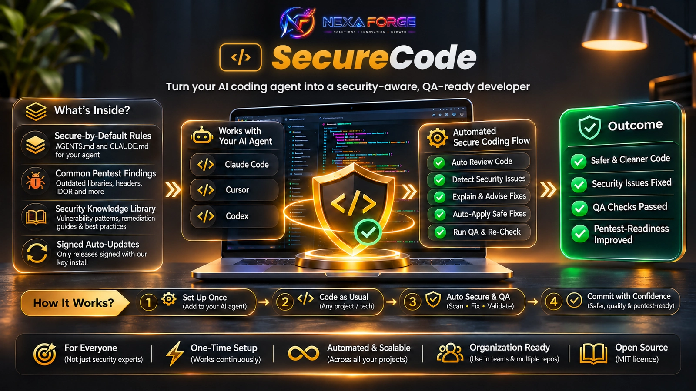

<h1 align="center"></h1>

<p align="center">
  <a href="https://github.com/farhan6667/nexaforge-securecode/actions/workflows/ci.yml"></a>
  <a href="LICENSE"></a>
  
  
</p>

**NexaForge SecureCode is a virtual pentester that sits next to every developer.** It makes AI coding agents
(Claude Code, Cursor, Codex) write secure code, finds and fixes security holes while you work, and keeps the
agent away from your secrets. Free and open source (MIT), for anyone who builds web apps, APIs or Android apps
with AI.

<p align="center">
  <a href="#install-with-one-prompt">Install</a> ·
  <a href="#what-you-get">What you get</a> ·
  <a href="#how-a-review-works">How a review works</a> ·
  <a href="#honest-limits">Limits</a> ·
  <a href="#frequently-asked-questions">FAQ</a> ·
  <a href="#contribute">Contribute</a>
</p>

## Pass the pentest the first time

The usual road to production is slow:

> code → staging → pentest (2 to 3 days) → report → **fail** → fix → staging → pentest again → ...

Most of those round trips are for the same known issues. SecureCode moves that first pentest pass to the
developer's desk, in real time:

> code **with a virtual pentester beside you** → fixed while you work → staging → pentest → **pass**

- **Real time.** Each change is checked as it is written, not days later.
- **Fixes that don't break things.** After a fix the agent re-runs the gate together with your project's own tests,
  so features keep working (the more tests your project has, the stronger this check).
- **Your security team's time goes further.** Human testers spend their days on the hard problems (business
  logic, chained attacks) instead of re-reporting old jQuery and missing headers.

It does not replace a human pentest. It makes the human pentest shorter and far more likely to pass in one go.

## Why you need it

AI writes code fast. Pentests keep finding the same holes in it: old jQuery, missing security headers, one
user reading another user's data (IDOR), weak cookies, debug output. And the agent itself can be tricked by a
poisoned file into reading your `.env` or pushing your code somewhere public.

SecureCode fixes both:

- **Secure by default.** The agent follows a security checklist while it writes.
- **Checked before handover.** Type `Run Security Test` and it reviews, fixes and re-tests the code.
- **A guard on your machine.** It keeps the agent away from secrets, force pushes and other risky commands.

## Install with one prompt

Open Claude Code, Cursor or Codex and paste this one line:

```
Install NexaForge SecureCode for me: download the latest release from https://github.com/farhan6667/nexaforge-securecode/releases, verify its signature as https://github.com/farhan6667/nexaforge-securecode/blob/main/SECURITY.md explains, then follow ONE_PROMPT_INSTALL.md inside the zip.
```

The agent downloads it, checks the signature, installs it and the scanners, and tells you what it did. It asks
before installing anything, so just say yes. Then type `Run Security Test` in any project.

<details>
<summary>Install by hand instead</summary>

Download `NexaForge_SecureCode.zip` from the [latest release](https://github.com/farhan6667/nexaforge-securecode/releases), extract it, then:

```powershell
powershell -ExecutionPolicy Bypass -File .\install-windows.ps1
py verify-global.py
```

macOS or Linux: `./install-macos.sh` or `./install-linux.sh`, then `python3 verify-global.py`.

The full check uses Semgrep, Trivy and Gitleaks. Windows: `winget install --id AquaSecurity.Trivy --exact --source winget`,
`winget install --id Gitleaks.Gitleaks --exact --source winget`, `py -m pip install --user semgrep`.
macOS: `brew install semgrep trivy gitleaks`. Restart the AI tool afterwards.
</details>

## Install once, it updates itself

You never reinstall. Once a day a small task checks this repo for a newer release and installs it by itself,
so every new rule, fix and scanner check reaches you without doing anything.

- **Only signed releases.** Each release is signed with the NexaForge key. A tampered, unsigned or older
  release is refused, so even a stolen GitHub token cannot push bad code to your machine.
- **Your settings stay.** Your own branding and your organization's findings file are never overwritten.
- **No login needed** for the public repo. Every run is logged in `update.log`.
- **Update now by hand:** `py -I "%LOCALAPPDATA%\OrgAISecureAppSec\scripts\updater.py"` prints one line,
  such as `updated to 6.3.0` or `already up to date`.
- **Turn it off** any time: [see how](ENTERPRISE_DEPLOYMENT.md#auto-update).

## It fixes OWASP Top 10 issues while you vibe code

You don't need to know security. You ask for a feature, and the agent builds it the safe way from the first
line. Three layers work together:

1. **While writing**, the agent follows the rules, so the safe version is what gets written.
2. **After every edit** (Claude Code), a quick check flags risky code right away, and the agent fixes it in the same session.
3. **Before handover**, `Run Security Test` reviews the whole project, fixes what it safely can, re-tests it,
   and the gate blocks anything still high risk.

| Risk (OWASP Top 10 and common pentest findings) | What the agent does for you |
|---|---|
| **IDOR and broken access control** (user A opens user B's order) | checks ownership on every route, scopes queries to the logged-in user, adds a cross-user test; Laravel rules flag routes and controllers missing it |
| **SQL and command injection** | parameterized queries and argument lists only; Semgrep injection rules block the build |
| **XSS** | output encoding by default; flags raw template output (Blade `{!! !!}`, Twig `raw`, React raw HTML) |
| **Mass assignment** | no `$request->all()` into models; the rule catches it, including through a variable |
| **Security misconfiguration** | security headers per framework, secure cookies, debug off, no exposed `.git` or backups in the web root |
| **Outdated libraries** | finds old jQuery, Bootstrap and other packages (Trivy, plus Retire.js when installed) and upgrades instead of hiding them |
| **Secrets in code** | Gitleaks plus a hard rule: no keys or passwords in code, tests or commits |
| **Weak crypto and auth** | no MD5/SHA1 for passwords, secure random tokens, TLS checks on, login rate limits |
| **Unsafe uploads** | type and content checks, private storage, scripts refused |
| **Supply chain** | asks before any new package and checks it exists and is not days old (`package_age.py`) |

It also protects you from the agent: a poisoned file in a cloned repo cannot make it read your `.env`,
change its own settings or push your code somewhere public.

## How it is different

| | Plain scanner | AI review only | Rules file only | **NexaForge SecureCode** |
|---|:---:|:---:|:---:|:---:|
| Secure code from the first line | no | no | yes | **yes** |
| Finds issues after each edit | no | no | no | **yes (Claude Code)** |
| Fixes the code and re-tests it | no | sometimes | no | **yes** |
| Real scanners (Semgrep, Trivy, Gitleaks) | yes | no | no | **yes** |
| Access control (IDOR) rules and tests | rarely | sometimes | no | **yes** |
| Guards your machine from the agent | no | no | no | **yes** |
| Signed auto-updates | varies | no | no | **yes** |
| Works with Claude Code, Cursor and Codex | n/a | one tool | one tool | **all three** |
| Measured on a lab with planted bugs | varies | no | no | **yes, 17 of 18** |

Everything runs on your machine. Your code is not sent to any NexaForge service (your AI tool still talks to its own model provider, as usual). The limits are listed
plainly under [Honest limits](#honest-limits).

## What you get

| Part | What it does |
|---|---|
| Secure-by-default rules | `AGENTS.md` and a global `CLAUDE.md` block: validate input on the server, parameterized queries, output encoding, authorization on every route, no secrets in code, ask before new dependencies |
| Deep review: `Run Security Test` | the agent walks every entry point with [docs/SOURCE-CODE-REVIEW.md](docs/SOURCE-CODE-REVIEW.md), fixes what it safely can, re-runs the gate and reports a verdict |
| Readiness advisory: `Run Advisory QA` | the same review, but nothing changes until you agree |
| The gate, `secgate.py` | Semgrep (our rules, Laravel authorization rules, registry packs), Trivy, Gitleaks, your project's tests, and built-in checks for outdated front-end libraries, web-root exposure, cookies, headers, TLS, default credentials, raw template output and Android manifests. `ci` mode fails closed |
| Agent guard | a Claude Code hook that blocks reading secrets, writing to the agent's own settings, pipe-to-shell, force pushes and public repo creation, and asks before pushes and installs |
| CI templates | GitHub and GitLab, with actions pinned to commit SHAs and scanners pinned by SHA-256 |
| Templates | Laravel security headers, session, throttling, upload and webhook scaffolds, plus example security tests |

You can also use `/security-gate` and `/advisory-qa`, or just ask in your own words.

### Everything it does for you

**While the agent works**
- Stops it from reading `.env` files, private keys and credentials, even through tricks like renamed paths,
  links or encoded names.
- Stops it from changing its own settings, hooks or rules, so a malicious file cannot switch the protection off.
- Blocks force pushes, `curl | sh` installs, deleting your home folder and creating public repos; asks you before
  any push or package install.
- Watches what it reads (files, web pages, MCP tool output) for hidden Unicode and planted instructions, and
  reminds it that this is data, not orders.
- Before it says "done", checks the changed files once more and sends it back if a High or Critical issue is
  still open.

**When you ask for a review**
- `Run Security Test`: a pentester-style source review of every route and API, then fix, re-test and a verdict.
- `Run Advisory QA`: the same review as a readiness report; nothing changes until you agree.
- `/sec-review`: a threat model plus a deep review of the repo and your latest changes, with fixes and re-tests.
- Checks Android manifests (debuggable, backups, cleartext traffic, exported components).
- A matrix of who may do what (roles against routes), where every row needs a passing test.

**For teams and companies**
- CI templates for GitHub and GitLab that fail the merge on High findings, with the gate fetched from a
  central repo so a pull request cannot weaken it.
- A managed install that developers cannot switch off, for Intune, GPO or SCCM.
- Exceptions with an owner, a reason and an expiry date; an expired exception brings the finding back by itself.
- Your own product name through one setting, kept across updates.
- Optional staging scans with OWASP ZAP or nuclei, only when you explicitly allow them for that URL.
- Optional webhook to send findings to your tracker.

**Proof, not promises**
- 145 automated tests, CI on Windows and Linux with Python 3.10, 3.12 and 3.13.
- A Laravel lab with 18 planted vulnerabilities: the full gate finds 17, and the one it misses is documented.
- The repo scans itself with its own gate on every push.

## How a review works

1. The agent reads the project and lists every route, form, upload and API endpoint.
2. For access control it writes `.security/authz-matrix.md` (route, verb, who may call it, which objects) and
   one cross-user test per row. A row without a passing test stays open.
3. It runs the gate, fixes what it safely can, and runs the gate again.
4. It reports a verdict, a findings table, the fixes and a short script you can run to check them yourself.

Proof on a small lab: on our own Laravel lab with 18 planted issues the full gate found 17
([benchmark/RESULTS.md](benchmark/RESULTS.md)). We wrote that lab ourselves, so it shows the checks work as
designed, not how much a real pentest will find. The one it misses is listed there on purpose.

## Check a project without the AI

```bash
py "%LOCALAPPDATA%\OrgAISecureAppSec\scripts\secgate.py" . --mode ci --fail-on high --run-tests
```

`RESULT: PASS` means no High or Critical finding. Reports go to `.security/findings.json` and `.security/findings.sarif`.

## For teams

Per-user installs can be removed by their user. Real enforcement is the managed install (read-only runtime,
admin-owned settings) and the CI required check that a pull request cannot change. An organization can also
ship the package under its own internal name and still receive the signed updates. All of this is in
[ENTERPRISE_DEPLOYMENT.md](ENTERPRISE_DEPLOYMENT.md).

## Honest limits

- The guard matches patterns. It reduces risk, it is not a sandbox, and native Windows has no Claude Code OS sandbox.
- The deep review is done by the AI and can miss things, especially business logic. Keep the human pentest.
- Server settings (TLS ciphers, open ports, admin panels on the host) are outside the code and are listed for the server team.
- Cursor and Codex get the rules, the gate and guard adapters with gaps: Cursor has no hook before file edits, and
  Codex hooks cannot ask yet, so an "ask" is a deny there. Details in [docs/AI-AGENT-SECURITY.md](docs/AI-AGENT-SECURITY.md).

**Owner mode.** On your own machine the guard asks instead of refusing when you may really want the action: a force
push, `git reset --hard`, a public repo or gist, `npm publish`. The prompt shows the exact command, and every ask is
logged to `.security/guard-audit.jsonl`. Secrets and pipe-to-shell are still refused. Managed installs keep refusing
all of it. When you finish a bigger change, the agent also offers to run "Run Security Test" once.
- No tool proves software is free of vulnerabilities. Known gaps are in [SECURITY-CONTEXT.md](SECURITY-CONTEXT.md).

## Frequently asked questions

**What is NexaForge SecureCode?**
A set of rules, a code review method, a scanner gate and Claude Code hooks that make AI coding agents produce
more secure code and protect the developer's machine from the agent. It is free and MIT licensed.

**Does it work with Cursor and Codex, or only Claude Code?**
The rules, the deep review and the gate work with all three. The agent guard also runs in Cursor and Codex through
small adapters (Cursor: shell, MCP and file reads; Codex: shell, patches and MCP, plus the stop gate). The per-edit
check and the injection watch are Claude Code only. Setup is in [docs/AI-AGENT-SECURITY.md](docs/AI-AGENT-SECURITY.md).

**Will it make my app pass a pentest?**
It removes the findings pentests report most often and makes the agent test access control route by route, so
fewer issues reach the tester. It cannot promise a clean report: business logic and server setup still need a person.

**Does it send my code anywhere?**
The gate and the hooks run on your machine. Semgrep downloads its registry rules, and the updater checks this
GitHub repo for new releases. Your AI tool itself talks to its own provider as usual.

**Is the auto-update safe?**
It installs only releases signed with the NexaForge release key, never an older version, and it refuses unsafe
paths inside the zip. A stolen GitHub login alone cannot push an update to your machine.

**Do I have to type the phrases exactly?**
No. "Run Security Test" and "Run Advisory QA" are the shortcuts, and `/security-gate` and `/advisory-qa` do the
same. Asking in your own words, like "check this project for security issues before I ship", works too. The
Roman Urdu versions "Security Test Karo" and "Advisory QA Karo" also work.

## Contribute

The most useful thing you can send is a **compatibility report**: install it on your own stack and tell us what
it found, what it missed and where it was noisy. Bug fixes, new checks with a test, and clearer docs are welcome
too. Start with the [contributing guide](CONTRIBUTING.md) or a
[good first issue](https://github.com/farhan6667/nexaforge-securecode/labels/good%20first%20issue), or say hello in
[Discussions](https://github.com/farhan6667/nexaforge-securecode/discussions). Please report vulnerabilities in
SecureCode itself privately, see [SECURITY.md](SECURITY.md).

## Sponsor my work

<p align="center">
  <a href="https://github.com/farhan6667/farhan6667/blob/main/SPONSOR.md"><picture>
    <source media="(prefers-color-scheme: dark)" srcset="docs/img/sponsor-button-dark.webp">
    
  </picture></a>
</p>

If your team uses SecureCode, sponsoring keeps the rules current with new CVEs and new agent features.

## License

MIT, see [LICENSE](LICENSE). The NexaForge name and logo are not covered by the licence, see [NOTICE](NOTICE).
Independent project, not affiliated with Anthropic, Anysphere (Cursor), OpenAI, Semgrep, Aqua Security or OWASP.
More open source work by the same author: [HexSwarm](https://github.com/farhan6667/hexswarm),
[no-api-media-mcp](https://github.com/farhan6667/no-api-media-mcp) and others on [GitHub](https://github.com/farhan6667).

---

<div align="center">

<a href="https://nexaforge.eu.cc/">
  <picture>
    <source media="(prefers-color-scheme: dark)" srcset="docs/img/brand/nexaforge-lockup-dark.webp">
    
  </picture>
</a>

**Built by [Syed Farhan Ahmed](https://github.com/farhan6667) (SFA)** at **[NexaForge](https://nexaforge.eu.cc/)**<br>
Cyber security · Vibe coding · Web development and IT infrastructure

[Website](https://nexaforge.eu.cc/) ·
[LinkedIn](https://www.linkedin.com/in/sfa6667) ·
[Portfolio](https://farhan6667.github.io/portfolio/) ·
[Email](mailto:nexaforge.services@gmail.com)

</div>
