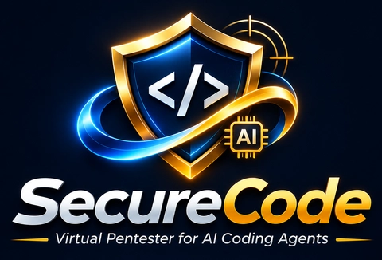
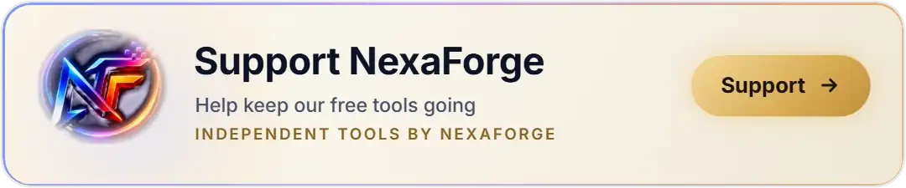

<h1 align="center"></h1>

<p align="center">
  <a href="https://github.com/farhan6667/nexaforge-securecode/actions/workflows/ci.yml"></a>
  <a href="LICENSE"></a>
  
  
</p>

**NexaForge SecureCode is a virtual pentester that sits next to every developer.** It makes AI coding agents
write secure code, finds and fixes security holes while you work, and keeps the agent away from your secrets.
Works with Claude Code, Cursor, Codex, Gemini CLI and Antigravity (rules, gate and agent guard in all five; the
full hooks in Claude Code, guard adapters for the other four). Free and open source (MIT), for anyone who builds web apps,
APIs or Android apps with AI.

<p align="center"></p>

<p align="center">
  <a href="#whats-new-in-70">What's new</a> ·
  <a href="#install-with-one-prompt">Install</a> ·
  <a href="#what-you-get">What you get</a> ·
  <a href="#how-a-review-works">How a review works</a> ·
  <a href="#honest-limits">Limits</a> ·
  <a href="#frequently-asked-questions">FAQ</a> ·
  <a href="#contribute">Contribute</a>
</p>

## What's new in 7.0

- **A guard that allows what is clearly safe and asks about the rest.** Everyday commands inside your project run
  without a prompt (1 of 256 everyday commands asked in our test); anything unusual shows you the exact command
  first. Secrets and the agent's own settings stay off limits. Cursor, Codex, Gemini CLI and Antigravity get guard
  adapters too.
- **More scanners, picked by language:** osv-scanner, Bandit, pip-audit, gosec, govulncheck, ESLint security,
  Dependency-Check and SpotBugs, installed pinned and hash-checked (each engine's own package; pip and npm
  dependencies are resolved, not hash-pinned) with one setup command.
- **New rules and labs:** Java and Spring Boot, a legacy audit for planted webshells, database and default-password
  checks. Lab scores: Laravel 18/18, Spring 20/20, legacy 17/17, web 22/22, no clean file flagged.
- **Secrets stay out of the agent's view:** the secret shield masks keys and tokens in tool output before the
  agent reads them, and `mcp_scan.py` checks your MCP server configs offline for plain-text tokens and unpinned
  packages.
- **Automated pentest flow:** a passive ZAP scan of your own app, a readable report, and a draft fix pull request.
- **Gemini CLI and Antigravity** get the rules, the gate and the agent guard.
- **Updates that catch up:** a laptop that was off at check time updates as soon as it can, and 6.x installs move
  to 7.0 by themselves. Details in [RELEASE-NOTES-V7.0.md](RELEASE-NOTES-V7.0.md).

## Pass the pentest the first time

The usual road to production is slow:

> code → staging → pentest (2 to 3 days) → report → **fail** → fix → staging → pentest again → ...

Most of those round trips are for the same known issues. SecureCode moves that first pentest pass to the
developer's desk, in real time:

> code **with a virtual pentester beside you** → fixed while you work → staging → pentest → **pass**

- **Real time.** Each change is checked as it is written, not days later.
- **Fixes that don't break things.** The gate can run your project's own tests (`--run-tests`), and the review
  protocol tells the agent to re-run them after every fix.
- **Your security team's time goes further.** Human testers spend their days on the hard problems (business
  logic, chained attacks) instead of re-reporting old jQuery and missing headers.

It does not replace a human pentest. It makes the human pentest shorter and far more likely to pass in one go.

## Why you need it

AI writes code fast. Pentests keep finding the same holes in it: old jQuery, missing security headers, one
user reading another user's data (IDOR), weak cookies, debug output. And the agent itself can be tricked by a
poisoned file into reading your `.env` or pushing your code somewhere public.

SecureCode fixes both:

- **Secure by default.** The agent follows a security checklist while it writes.
- **Checked before handover.** Type `Run Security Test` and it reviews, fixes and re-tests the code.
- **A guard on your machine.** It keeps the agent away from secrets, force pushes and other risky commands.

## Install with one prompt

Open Claude Code, Cursor, Codex, Gemini CLI or Antigravity and paste this one line:

```
Install NexaForge SecureCode for me: download the latest release zip and its .sig from https://github.com/farhan6667/nexaforge-securecode/releases, check that the key in aisec/config/allowed_signers inside the zip has the fingerprint published in https://github.com/farhan6667/nexaforge-securecode/blob/main/SECURITY.md, verify the signature with ssh-keygen (in PowerShell through cmd /c, because PowerShell rejects "<"), extract it to a folder I choose, then follow ONE_PROMPT_INSTALL.md inside its aisec folder: run the installer, securecode.py doctor and securecode.py setup --yes on my project folder after asking me once, verify-global.py, and tell me to restart.
```

The agent downloads it, checks the key fingerprint and the signature, installs it and the scanners, and tells
you what it did. It asks before installing anything, so just say yes. Restart the AI tool, then type
`Run Security Test` in any project. [ONE_PROMPT_INSTALL.md](ONE_PROMPT_INSTALL.md) lists every step and explains
why the fingerprint in SECURITY.md is the trust anchor.

<details>
<summary>Install by hand instead</summary>

Download `NexaForge_SecureCode.zip` and `NexaForge_SecureCode.zip.sig` from the
[latest release](https://github.com/farhan6667/nexaforge-securecode/releases), check the key fingerprint and the
signature as [SECURITY.md](SECURITY.md#verifying-a-release) shows, extract it, then change into the `aisec`
folder inside (every file in the zip sits under it) and run:

```powershell
cd aisec
powershell -ExecutionPolicy Bypass -File .\install-windows.ps1
py -I scripts/securecode.py doctor "C:\path\to\your\project"
py -I scripts/securecode.py setup --yes "C:\path\to\your\project"
py verify-global.py
```

`doctor` and `setup` look at the folder you name; without one they look at the SecureCode package itself.
`setup --yes --all` installs every engine instead. macOS or Linux: `./install-macos.sh --update-timer` or
`./install-linux.sh --update-timer`, then the same commands with `python3`. Restart the AI tool afterwards.
</details>

## Install once, it updates itself

You never reinstall. Once a day a small task checks this repo for a newer release and installs it by itself,
so every new rule, fix and scanner check reaches you without doing anything.

- **Only signed releases.** Each release is signed with the NexaForge key. A tampered, unsigned or older
  release is refused, so even a stolen GitHub token cannot push bad code to your machine.
- **Your settings stay.** Your own branding and your organization's findings file are never overwritten.
- **No login needed** for the public repo. Every run is logged in `update.log`.
- **Catches up.** A laptop that was off at check time checks as soon as it can (Task Scheduler on Windows; a
  systemd timer or launchd agent with `install-global.py --update-timer` on Linux and macOS).
- **Update now by hand:** `py -I "$env:LOCALAPPDATA\OrgAISecureAppSec\scripts\updater.py"` (PowerShell) prints one line,
  such as `updated to 7.0.0` or `already up to date`.
- **Turn it off** any time: [see how](ENTERPRISE_DEPLOYMENT.md#auto-update).

## It fixes OWASP Top 10 issues while you vibe code

You don't need to know security. You ask for a feature, and the agent builds it the safe way from the first
line. Three layers work together:

1. **While writing**, the agent follows the rules, so the safe version is what gets written.
2. **After every edit** (Claude Code), a quick check flags risky code right away, and the agent fixes it in the same session.
3. **Before handover**, `Run Security Test` reviews the whole project, fixes what it safely can, re-tests it,
   and the gate blocks anything still high risk.

| Risk (OWASP Top 10 and common pentest findings) | What the agent does for you |
|---|---|
| **IDOR and broken access control** (user A opens user B's order) | checks ownership on every route, scopes queries to the logged-in user, adds a cross-user test; Laravel rules flag routes and controllers missing it |
| **SQL and command injection** | parameterized queries and argument lists only; Semgrep injection rules block the build |
| **XSS** | output encoding by default; flags raw template output (Blade `{!! !!}`, Twig `raw`, React raw HTML) |
| **Mass assignment** | no `$request->all()` into models; the rule catches it, including through a variable |
| **Security misconfiguration** | security headers per framework, secure cookies, debug off, no exposed `.git` or backups in the web root |
| **Outdated libraries** | finds old jQuery, Bootstrap and other packages (Trivy, plus Retire.js when installed) and upgrades instead of hiding them |
| **Secrets in code** | Gitleaks plus a hard rule: no keys or passwords in code, tests or commits |
| **Weak crypto and auth** | no MD5/SHA1 for passwords, secure random tokens, TLS checks on, login rate limits |
| **Unsafe uploads** | type and content checks, private storage, scripts refused |
| **Supply chain** | asks before any new package and checks it exists and is not days old (`package_age.py`) |

It also protects you from the agent: a poisoned file in a cloned repo cannot make it read your `.env`,
change its own settings or push your code somewhere public.

## How it is different

| | Plain scanner | AI review only | Rules file only | **NexaForge SecureCode** |
|---|:---:|:---:|:---:|:---:|
| Secure code from the first line | no | no | yes | **yes** |
| Finds issues after each edit | no | no | no | **yes (Claude Code)** |
| Fixes the code and re-tests it | no | sometimes | no | **yes** |
| Real scanners (Semgrep, Trivy, Gitleaks) | yes | no | no | **yes** |
| Access control (IDOR) rules and tests | rarely | sometimes | no | **yes** |
| Guards your machine from the agent | no | no | no | **yes** |
| Signed auto-updates | varies | no | no | **yes** |
| Works with Claude Code, Cursor, Codex, Gemini CLI and Antigravity | n/a | one tool | one tool | **all five, guard included (Cursor's own file edits not yet)** |
| Measured on labs with planted bugs | varies | no | no | **yes: four labs, 77 of 77 found, 0 clean files flagged** |

## Works with

| Tool | Rules and gate | Agent guard | Gaps |
|---|---|---|---|
| Claude Code | yes, installed for you | yes, every tool (hooks) | none known; native Windows has no OS sandbox |
| Cursor | yes | shell, MCP and file reads (`cursor_hook.py`) | Cursor's own file edits are not checked yet |
| Codex | yes | shell, patches and MCP (`codex_hook.py`), plus the stop gate | an "ask" becomes a deny |
| Gemini CLI | yes | every tool (`gemini_hook.py`, BeforeTool) | an "ask" becomes a deny |
| Antigravity | yes | every tool (`antigravity_hook.py`, PreToolUse), asks work | blocking when the hook itself fails is untested |

The installer writes the guard hook for the other four tools when you name them. It backs up the tool's config
file first and merges into it, so your other settings and hooks stay:

```powershell
py -I install-global.py --agent cursor --agent codex      # also: --agent gemini, --agent antigravity
```

`verify-global.py` lists which tools have the hook. The rules file (`AGENTS.md`) and the manual way are in
[docs/AI-AGENT-SECURITY.md](docs/AI-AGENT-SECURITY.md).

Everything runs on your machine. Your code is not sent to any NexaForge service (your AI tool still talks to its own model provider, as usual). The limits are listed
plainly under [Honest limits](#honest-limits).

## What you get

| Part | What it does |
|---|---|
| Secure-by-default rules | `AGENTS.md` and a global `CLAUDE.md` block: validate input on the server, parameterized queries, output encoding, authorization on every route, no secrets in code, ask before new dependencies |
| Deep review: `Run Security Test` | the agent walks every entry point with [docs/SOURCE-CODE-REVIEW.md](docs/SOURCE-CODE-REVIEW.md), fixes what it safely can, re-runs the gate and reports a verdict |
| Readiness advisory: `Run Advisory QA` | the same review, but nothing changes until you agree |
| The gate, `secgate.py` | Semgrep (our rules, Laravel authorization rules, registry packs), Trivy, Gitleaks, your project's tests, and built-in checks for outdated front-end libraries, web-root exposure, cookies, headers, TLS, default credentials, raw template output and Android manifests. `ci` mode fails closed |
| Agent guard | a Claude Code hook (with adapters for Cursor, Codex, Gemini CLI and Antigravity) that blocks reading secrets, writing to the agent's own settings, pipe-to-shell, force pushes and public repo creation, and asks before pushes and installs |
| CI templates | GitHub and GitLab, with actions pinned to commit SHAs and scanners pinned by SHA-256 |
| Templates | Laravel security headers, session, throttling, upload and webhook scaffolds, plus example security tests |

You can also use `/security-gate` and `/advisory-qa`, or just ask in your own words.

### Everything it does for you

**While the agent works**
- Stops it from reading `.env` files, private keys and credentials, even through tricks like renamed paths,
  links or encoded names.
- Stops it from changing its own settings, hooks or rules, so a malicious file cannot switch the protection off.
- Blocks force pushes, `curl | sh` installs, deleting your home folder and creating public repos; asks you before
  any push or package install.
- Watches what it reads (files, web pages, MCP tool output) for hidden Unicode and planted instructions, and
  reminds it that this is data, not orders.
- Before it says "done", checks the changed files once more and sends it back if a High or Critical issue is
  still open.

**When you ask for a review**
- `Run Security Test`: a pentester-style source review of every route and API, then fix, re-test and a verdict.
- `Run Advisory QA`: the same review as a readiness report; nothing changes until you agree.
- `/sec-review`: a threat model plus a deep review of the repo and your latest changes, with fixes and re-tests.
- `Run Legacy Audit` (part of the security test for old or inherited code): finds webshells, request-driven
  backdoors, PHP hidden in upload or image folders and encoded payloads, and shows them to you before anything
  is deleted. It also lists functions that break on the way to PHP 8.5.
- Java and Spring Boot rules: IDOR, mass assignment, SQL/JPQL concatenation, XXE, unsafe deserialization,
  SpEL and JNDI injection, permitAll on admin paths, disabled CSRF, exposed Actuator, trust-all TLS.
- Database settings: root or default users, empty passwords, no TLS, listening on every interface, GRANT ALL,
  card and plain-text password columns.
- Checks Android manifests (debuggable, backups, cleartext traffic, exported components).
- A matrix of who may do what (roles against routes), where every row needs a passing test.

**For teams and companies**
- CI templates for GitHub and GitLab that fail the merge on High findings, with the gate fetched from a
  central repo so a pull request cannot weaken it.
- A managed install that developers cannot switch off, for Intune, GPO or SCCM.
- Exceptions with an owner, a reason and an expiry date; an expired exception brings the finding back by itself.
- Your own product name through one setting, kept across updates.
- Optional staging scans with OWASP ZAP or nuclei, only when you explicitly allow them for that URL.
- Optional webhook to send findings to your tracker.

**Proof, not promises**
- {{TESTCOUNT}} test cases (counted with pytest --collect-only, parametrized cases included), run in CI on Windows and Linux with Python 3.10, 3.12 and 3.13.
- Four labs with planted vulnerabilities (Laravel, Spring Boot, legacy webshells, common pentest findings),
  each with clean files that must stay quiet. Scores and every miss are in
  [benchmark/RESULTS.md](benchmark/RESULTS.md).
- An honest map to OWASP Top 10:2025, CWE Top 25 (2025) and the OWASP API Top 10 2023, marking each item
  caught, partial, review only or not yet: [docs/STANDARDS-COVERAGE.md](docs/STANDARDS-COVERAGE.md).
  The OWASP ASVS 5.0 chapters (V1 to V17) are mapped there too, as guidance for reviewers, not a compliance claim.
- The repo scans itself with its own gate on every push.

## How a review works

1. The agent reads the project and lists every route, form, upload and API endpoint.
2. For access control it writes `.security/authz-matrix.md` (route, verb, who may call it, which objects) and
   one cross-user test per row. A row without a passing test stays open.
3. It runs the gate, fixes what it safely can, and runs the gate again.
4. It reports a verdict, a findings table, the fixes and a short script you can run to check them yourself.

Proof on a small lab: on our own Laravel lab with 18 planted issues the full gate found 18 of 18 and
reported none of the 4 clean files ([benchmark/RESULTS.md](benchmark/RESULTS.md)). We wrote that lab
ourselves, so it shows the checks work as designed, not how much a real pentest will find. The other three
labs and every miss are listed there too.

## Check a project without the AI

```powershell
py -I "$env:LOCALAPPDATA\OrgAISecureAppSec\scripts\secgate.py" . --mode ci --fail-on high --run-tests
```

`RESULT: PASS` means no High or Critical finding. Reports go to `.security/findings.json` and `.security/findings.sarif`.
`RESULT: BLOCKED` exits with 2 when a finding is at or above `--fail-on`, and with 3 in `ci` mode when a required
scanner (Semgrep, Trivy, Gitleaks) is missing or failed to run; a pass exits with 0.

## Scanners it sets up for you

The gate looks at which languages your project uses and runs the matching scanners in `full` and `ci` mode.
It never copies a scanner into this package: each one runs as its own program, and a missing one shows up as
`NOTE: not run: <name> (install with: py -I "$env:LOCALAPPDATA\OrgAISecureAppSec\scripts\securecode.py" setup)`
(the PowerShell form on Windows; the macOS and Linux note names the installed path there), never as a pass and never as a failure.

```powershell
py -I "$env:LOCALAPPDATA\OrgAISecureAppSec\scripts\securecode.py" doctor        # what this project needs, what is installed, which version
py -I "$env:LOCALAPPDATA\OrgAISecureAppSec\scripts\securecode.py" setup         # the install plan: source, pinned version, checksum, licence
py -I "$env:LOCALAPPDATA\OrgAISecureAppSec\scripts\securecode.py" setup --yes   # your one yes: installs the plan, checking every checksum
```

Run these from your project folder, or name it after the command (`doctor "C:\path\to\project"`,
`setup --yes "C:\path\to\project"`); `setup --all` plans every engine. `%LOCALAPPDATA%` works only in cmd, so
use the `$env:LOCALAPPDATA` form above in PowerShell.
macOS: `python3 -I "$HOME/Library/Application Support/OrgAISecureAppSec/scripts/securecode.py" setup`. Linux:
`python3 -I "${XDG_DATA_HOME:-$HOME/.local/share}/OrgAISecureAppSec/scripts/securecode.py" setup`.

Nothing is installed without `--yes`. Tools go to `$env:LOCALAPPDATA\NexaForgeTools` (Windows) or
`~/.local/share/nexaforge-tools`, outside your projects. Every download comes from the publisher's own release
page at a pinned version and is checked against a SHA-256 written in
[scripts/engines/engines.lock.json](scripts/engines/engines.lock.json); a mismatch is deleted and refused. That
pins each engine's own package; for pip and npm engines, their dependencies are resolved, not hash-pinned.

OWASP ZAP for the local DAST step is installed the same way, only when you ask for it:
`py -I "$env:LOCALAPPDATA\OrgAISecureAppSec\scripts\securecode.py" setup --engine zap` (PowerShell) downloads the official
ZAP 2.17.0 cross-platform zip (SHA-256 and size pinned) into the tools folder. ZAP needs Java 17 or newer;
`doctor` and `setup` say clearly when Java is missing or too old, and SecureCode never installs Java for you.

| Language | Engine | Licence | What it finds |
|---|---|---|---|
| Every project | Semgrep | LGPL-2.1, separate program | injection, XSS, unsafe APIs and auth mistakes, with our own rules plus registry packs |
| Every project | Trivy | Apache-2.0 | vulnerable dependencies, IaC and container misconfigurations, secrets |
| Every project | Gitleaks | MIT | secrets in source and git history |
| Every project | osv-scanner | Apache-2.0 | vulnerable dependencies in lockfiles, a second opinion next to Trivy |
| Python | Bandit | Apache-2.0 | shell injection, eval and exec, pickle, weak crypto, TLS verification switched off |
| Python | pip-audit | Apache-2.0 | vulnerable pinned packages in `requirements*.txt` |
| Go | gosec | Apache-2.0 | SQL and command injection, path traversal, weak crypto, file permissions |
| Go | govulncheck | BSD-3-Clause | vulnerable modules, ranked by whether your code really calls the vulnerable function |
| Node.js | npm audit | part of npm | vulnerable packages in `package-lock.json` |
| Node.js | eslint-plugin-security on ESLint | Apache-2.0, MIT | eval, child_process, unsafe regex (ReDoS), non-literal file paths and `require` |
| Node.js, web | Retire.js | Apache-2.0 | old front-end libraries with known vulnerabilities |
| Java | OWASP Dependency-Check | Apache-2.0 | vulnerable Maven, Gradle and JAR dependencies (NVD) |
| Java | SpotBugs with Find Security Bugs | LGPL, separate program | SQL, command and LDAP injection, XXE, unsafe deserialization in compiled classes |
| PHP | Psalm taint analysis | MIT | user input reaching SQL, shell, file and HTML sinks (a project dev dependency, runs with `--run-tests`) |
| .NET | Security Code Scan | LGPL-3.0, separate program | injection, XSS and weak crypto; manual install, runs with `--run-tests`; last release 2022 |
| Several | CodeQL | GitHub's own terms for the CLI | deep data-flow analysis; opt-in only, see below |

Some engines ask online databases about your dependencies: osv-scanner (api.osv.dev), govulncheck
(vuln.go.dev), npm audit (the npm registry) and pip-audit (PyPI). They send package names and versions, not
your source code. Dependency-Check downloads the NVD data; set `NVD_API_KEY` to make the first download fast.

**CodeQL is never installed for you.** The CodeQL CLI is free for open source and academic research, but using
it on private commercial code needs a paid GitHub licence. If your licence covers it, install the CLI yourself,
put `codeql` on PATH and set `SECGATE_CODEQL=1`; the gate then runs the security-extended queries without
building your code.

**AI pentest agents are not part of this release.** Tools such as Strix and PentAGI run real attacks against a
running site, need Docker and your own model key, and can change data. We plan to support them later as
optional external engines for staging and lab environments only.

## Automated pentest when you're done

After `Run Security Test` has fixed what it can, the agent finishes the job the way a pentester would:

| Step | What happens | What it needs |
|---|---|---|
| Local DAST | asks once whether your app runs on this machine, then runs an OWASP ZAP baseline (or API) scan against it. Only `localhost`, `127.x.x.x` and `::1` are allowed; the name is resolved once and the IP pinned | ZAP (`setup --engine zap`) and Java 17+, or Docker. Without them it says so and carries on |
| Retest | every finding gets a label: Pass, Fail, Partial, Compensating control or Risk accepted. A Pass needs the test that proves it; a risk acceptance needs your name and a date | nothing extra |
| Report | `.security/REPORT.html` (print-ready A4) and `REPORT.md`: executive summary, what ran and what did not, findings with CIA impact, attack chains, artifacts, limits. `report_lint.py` checks it before handover | Chrome or Edge for the optional PDF |
| Fix PR | a dry run first; on your yes, a `securecode/fix-<date>` branch and a draft PR with the report summary. Never the default branch, never a force push, refused if gitleaks finds a secret in the change | `gh` (GitHub CLI) signed in, and gitleaks |

```powershell
py -I "$env:LOCALAPPDATA\OrgAISecureAppSec\scripts\local_dast.py" --target http://127.0.0.1:8000 --start "php artisan serve --port 8000"
py -I "$env:LOCALAPPDATA\OrgAISecureAppSec\scripts\report.py" --pdf
py -I "$env:LOCALAPPDATA\OrgAISecureAppSec\scripts\report_lint.py"
py -I "$env:LOCALAPPDATA\OrgAISecureAppSec\scripts\fix_pr.py" --add tests/Security/OrderPolicyTest.php
```

`--start` is only ever the command you type; nothing is started from files in the repo. The scan is passive
unless you add `--active`. It is still an automated test, not a replacement for a human pentest.

## For teams

Per-user installs can be removed by their user. Real enforcement is the managed install (read-only runtime,
admin-owned settings) and the CI required check that a pull request cannot change. An organization can also
ship the package under its own internal name and still receive the signed updates. All of this is in
[ENTERPRISE_DEPLOYMENT.md](ENTERPRISE_DEPLOYMENT.md).

## Honest limits

- The guard (7.0) allows only what it understands: everyday development commands whose every path stays inside your
  project or a temp folder. Anything else is shown to you for approval in owner mode and refused in managed mode;
  secrets, your agent's own config, startup files and the scanner tools folder are always refused. In our
  everyday-commands test, under 1 in 100 commands prompts. It still is not a sandbox: a script your agent wrote in an
  earlier step can do anything once it runs, and native Windows has no Claude Code OS sandbox. Use the native
  sandbox where you have it.
- The deep review is done by the AI and can miss things, especially business logic. Keep the human pentest.
- Server settings (TLS ciphers, open ports, admin panels on the host) are outside the code and are listed for the server team.
- Claude Code gets the full hooks. Cursor, Codex, Gemini CLI and Antigravity get guard adapters that
  `install-global.py --agent` writes for you, with gaps: Cursor's generic preToolUse hook is not wired to the guard
  yet, so Cursor's own file edits are not checked. Codex and Gemini CLI hooks cannot ask, so an "ask" is a deny
  there. Antigravity can ask, but whether it blocks a call when the hook itself crashes or times out is untested.
  Gemini CLI enforcement was checked live with the CLI's own test mode. For Codex and Antigravity the filled-in
  hook lines are tested through PowerShell, Windows PowerShell and cmd, but not yet in a live session.
  Details in [docs/AI-AGENT-SECURITY.md](docs/AI-AGENT-SECURITY.md).
- The review history up to 6.2.2 is five internal review rounds and two outside-style attack rounds (the second
  with fuzzing), each fix with a regression test, and one internal pentest round, which found V7P-01 to V7P-03,
  all fixed with tests. That is not a third-party audit.
- Local DAST is a passive ZAP scan by default; it finds configuration and header issues far more often than
  logic bugs. It has been run live: real OWASP ZAP 2.17.0 (the cross-platform zip, started with `java -jar`)
  against a throwaway local site on 2026-11-03 found 9 alerts, and the report PDF passed `report_lint.py`. The
  Docker path is untested. Attack chains in the report are a simple heuristic for a person to confirm.
- No tool proves software is free of vulnerabilities. Known gaps are in [SECURITY-CONTEXT.md](SECURITY-CONTEXT.md).

**Owner mode.** On your own machine the guard asks instead of refusing when you may really want the action: a force
push, `git reset --hard`, a public repo or gist, `npm publish`. The prompt shows the exact command, and every ask is
logged to `.security/guard-audit.jsonl`. Secrets and pipe-to-shell are still refused. Managed installs keep refusing
all of it. When you finish a bigger change, the agent also offers to run "Run Security Test" once.

## Frequently asked questions

**What is NexaForge SecureCode?**
A set of rules, a code review method, a scanner gate and Claude Code hooks that make AI coding agents produce
more secure code and protect the developer's machine from the agent. It is free and MIT licensed.

**Does it work with Cursor, Codex, Gemini CLI and Antigravity, or only Claude Code?**
The rules, the deep review, the gate and the agent guard work with all five. The guard runs in Claude Code
through its hooks, and in the others through small adapters that `install-global.py --agent` sets up (Cursor: shell, MCP and file
reads; Codex: shell, patches and MCP, plus the stop gate; Gemini CLI and Antigravity: every tool). The per-edit
check and the injection watch are Claude Code only. Setup is in [docs/AI-AGENT-SECURITY.md](docs/AI-AGENT-SECURITY.md)
and [templates/gemini/README.md](templates/gemini/README.md).

**Will it make my app pass a pentest?**
It removes the findings pentests report most often and makes the agent test access control route by route, so
fewer issues reach the tester. It cannot promise a clean report: business logic and server setup still need a person.

**Does it send my code anywhere?**
The gate and the hooks run on your machine. Semgrep downloads its registry rules, and the updater checks this
GitHub repo for new releases. Your AI tool itself talks to its own provider as usual.

**Is the auto-update safe?**
It installs only releases signed with the NexaForge release key, never an older version, and it refuses unsafe
paths inside the zip. A stolen GitHub login alone cannot push an update to your machine.

**Do I have to type the phrases exactly?**
No. "Run Security Test" and "Run Advisory QA" are the shortcuts, and `/security-gate` and `/advisory-qa` do the
same. Asking in your own words, like "check this project for security issues before I ship", works too. The
Roman Urdu versions "Security Test Karo" and "Advisory QA Karo" also work.

## Contribute

The most useful thing you can send is a **compatibility report**: install it on your own stack and tell us what
it found, what it missed and where it was noisy. Bug fixes, new checks with a test, and clearer docs are welcome
too. Start with the [contributing guide](CONTRIBUTING.md) or a
[good first issue](https://github.com/farhan6667/nexaforge-securecode/labels/good%20first%20issue), or say hello in
[Discussions](https://github.com/farhan6667/nexaforge-securecode/discussions). Please report vulnerabilities in
SecureCode itself privately, see [SECURITY.md](SECURITY.md).

## Sponsor my work

<p align="center">
  <a href="https://github.com/farhan6667/farhan6667/blob/main/SPONSOR.md"><picture>
    <source media="(prefers-color-scheme: dark)" srcset="docs/img/sponsor-button-dark.webp">
    
  </picture></a>
</p>

If your team uses SecureCode, sponsoring keeps the rules current with new CVEs and new agent features.

## License

MIT, see [LICENSE](LICENSE). The NexaForge name and logo are not covered by the licence, see [NOTICE](NOTICE).
Independent project, not affiliated with Anthropic, Anysphere (Cursor), OpenAI, Semgrep, Aqua Security or OWASP.
More open source work by the same author: [HexSwarm](https://github.com/farhan6667/hexswarm),
[no-api-media-mcp](https://github.com/farhan6667/no-api-media-mcp) and others on [GitHub](https://github.com/farhan6667).

---

<div align="center">

<a href="https://nexaforge.eu.cc/">
  <picture>
    <source media="(prefers-color-scheme: dark)" srcset="docs/img/brand/nexaforge-lockup-dark.webp">
    
  </picture>
</a>

**Built by [Syed Farhan Ahmed](https://github.com/farhan6667) (SFA)** at **[NexaForge](https://nexaforge.eu.cc/)**<br>
Cyber security · Vibe coding · Web development and IT infrastructure

[Website](https://nexaforge.eu.cc/) ·
[LinkedIn](https://www.linkedin.com/in/sfa6667) ·
[Portfolio](https://farhan6667.github.io/portfolio/) ·
[Email](mailto:nexaforge.services@gmail.com)

</div>
